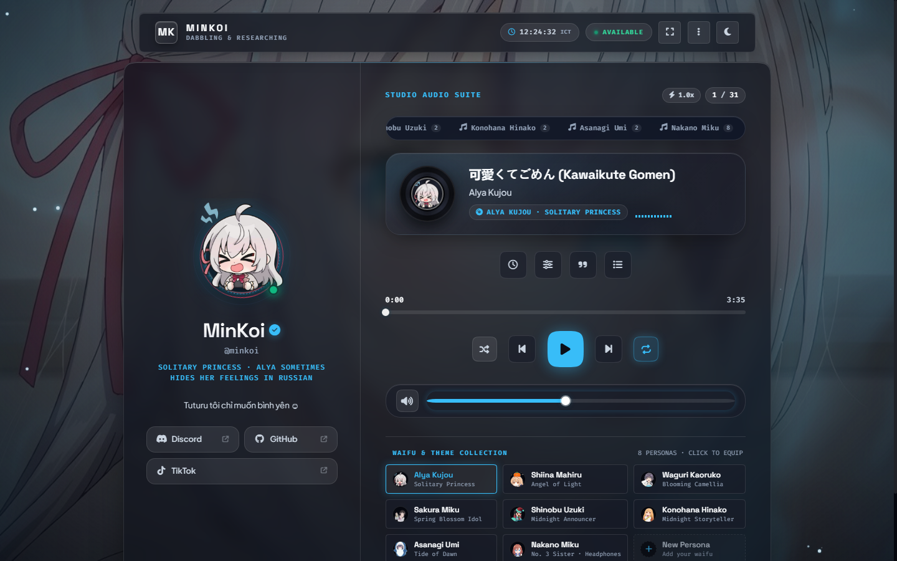
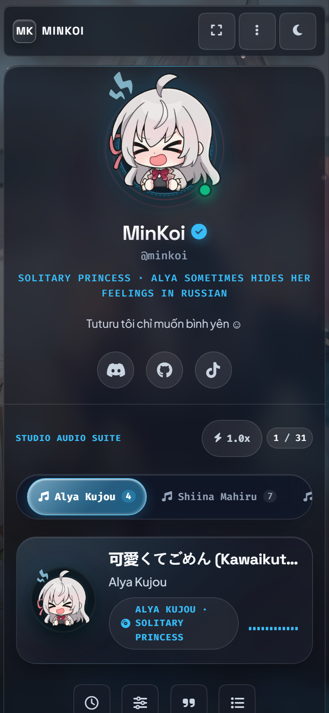

# MinKoi — Anime Music Studio

A responsive, client-side anime music studio and personal identity card built with vanilla JavaScript. The project combines HyperOS Miuix-inspired physics, translucent liquid glass navigation, reactive audio visualization, and a decoupled lyrics synchronization engine.

[](https://pro5-waifu-minkoi.vercel.app/)
[](LICENSE)
[](#tech-stack)

---

## Live Demo

- **Production URL**: [https://pro5-waifu-minkoi.vercel.app/](https://pro5-waifu-minkoi.vercel.app/)

---

## Preview

<div align="center">
  
  <br><br>
  
</div>

---

## Features

### 1. Studio Audio Suite & Persona Library
- **8 Curated Personas**: Alya Kujou, Shiina Mahiru, Waguri Kaoruko, Sakura Miku, Shinobu Uzuki, Konohana Hinako, Asanagi Umi, and Nakano Miku.
- **31 Audio Tracks**: Real duration data extracted directly from source MP3s.
- **Seamless Playlist Filtering**: Selecting a persona filters the playlist immediately without interrupting the currently playing audio.
- **Dual Responsive Wallpapers**: Automatic aspect-ratio detection (PC vs Mobile) with non-repeating random crossfade on persona transition.

### 2. Miuix Liquid Glass Navigation
- **Floating Liquid Capsule**: Translucent sliding navigation indicator positioned below the Studio Audio Suite.
- **Physics-Based Stretch & Squash**: Deforms dynamically based on spring velocity and drag displacement.
- **Continuous Touch Dragging**: Zero-lag finger tracking with rubberband resistance at boundaries and synchronous edge auto-scrolling at 60/120 fps.
- **Tactile Active Press Feedback**: Spring-damped press feedback (`scale(0.91-0.93)`) on playback and action controls.

### 3. Modular Lyrics Engine V2
- **Decoupled Architecture**: Independent modules for parsing, matching, caching, synchronization, rendering, and inline diagnostics.
- **Format Support**: Parses standard LRC, enhanced LRC with word timestamps, and TTML karaoke markup.
- **Continuous Sweep Rendering**: Syllable-level progressive gradient fill (Apple Music Sing style) with automatic fallback to line-level highlighting.
- **Best-Effort Timing**: Lyrics timestamps are best-effort and can be inspected or edited locally.

### 4. Audio Visualization & Ambient Lighting
- **64-Band Spectrum Visualizer**: Real-time frequency analysis rendered via HTML5 Canvas.
- **Reactive Disc Glow & Aura**: Bass and midrange frequencies modulate the vinyl platter rotation and avatar backdrop halo.
- **Waifu Adaptive Ambient**: The ambient background glow dynamically adapts to each persona's signature accent colors.

### 5. Performance Quality Tiers
- **Automatic Hardware Profiling**: Evaluates CPU logical cores and device memory to select an appropriate rendering mode:
  - **High**: Full GPU backdrop blur (`blur(14px)`), dynamic canvas particles, and smooth spring physics.
  - **Balanced**: Reduced blur (`blur(10px)`) and optimized particle counts for mid-tier mobile hardware.
  - **Eco (Tiết kiệm)**: Replaces GPU blur filters with solid high-contrast neon borders to eliminate frame drops on lower-end devices.

### 6. Zen Mode & Keyboard Shortcuts
- **Distraction-Free Mode**: Fullscreen visualizer with auto-dimming controls after 5 seconds of inactivity.
- **Screen Wake Lock API**: Prevents display sleep on supported mobile and desktop browsers during playback.
- **Keyboard Navigation**:
  - `Space` — Play / Pause
  - `J` / `K` — Previous / Next track
  - `M` — Mute / Unmute
  - `S` — Toggle Shuffle
  - `R` — Cycle Repeat mode (Off / All / One)
  - `Z` / `Esc` — Enter / Exit Zen Mode
  - `1` to `8` — Quick-switch persona

---

## Tech Stack

- **Markup & Layout**: HTML5, Semantic Elements, CSS3 (Modern Custom Properties, Flexbox, CSS Grid).
- **Styling Architecture**: Modular CSS with centralized design tokens (`css/tokens-v3.css`).
- **Core Runtime**: Vanilla JavaScript (ES2022+), zero third-party build tools, zero npm runtime dependencies.
- **Physics & Geometry**: Custom analytical damped harmonic spring engine (`js/ui/spring.js`) and squircle border calculation (`js/ui/squircle.js`).
- **Audio Processing**: Web Audio API (`AudioContext`, `AnalyserNode`, `BiquadFilterNode`).
- **Hosting & Edge Routing**: Vercel Static CDN.
- **Design References**: Inspired by interaction physics from [Compose Miuix UI](https://github.com/compose-miuix-ui/miuix) and material research from [Glasmio](https://github.com/NEORUAA/Glasmio). *MinKoi is an independent implementation and does not bundle Kotlin or Compose runtimes.*

---

## Project Structure

```text
profilecardwaifu/
├── assets/                  # Avatars (avatar_<key>.png) and responsive wallpapers
├── css/
│   ├── style-base.css       # Core tokens, reset, typography, and utility classes
│   ├── style-backgrounds.css# Fluid canvas background and wallpaper crossfading
│   ├── style-card.css       # Studio container, Zen mode overlay, and toasts
│   ├── style-left.css       # Persona card, avatar, bio, and social links
│   ├── style-right.css      # Studio Audio Suite, audio dock, seek bar, and flyouts
│   ├── style-responsive.css # Mobile and tablet responsive breakpoint rules
│   └── tokens-v3.css        # Miuix design tokens, spring curves, and glass indicator
├── js/
│   ├── config.js            # Central data configuration (personas and music library)
│   ├── avatar.js            # Persona switching and wallpaper management
│   ├── music.js             # Player lifecycle, Web Audio visualizer, and playlist
│   ├── stars.js             # Canvas particle starfield simulation
│   ├── fluid-bg.js          # Interactive ambient background animation
│   ├── features.js          # Theme switching, Zen mode, hotkeys, and quality profiling
│   ├── snapshot.js          # Profile snapshot sharing utility
│   ├── ui/
│   │   ├── spring.js        # Analytical spring physics solver
│   │   ├── squircle.js      # Continuous curvature squircle border generator
│   │   └── components.js    # Liquid glass navigation, list popups, and bottom sheets
│   └── lyrics/              # Decoupled Lyrics Engine V2
│       ├── parser.js        # TTML & LRC parser
│       ├── normalizer.js    # Title and metadata string normalizer
│       ├── matcher.js       # Confidence scoring and track matching
│       ├── cache.js         # In-memory and local storage lyrics cache
│       ├── sync-engine.js   # RAF audio clock tracking and line activation
│       ├── renderer.js      # Continuous syllable sweep and DOM renderer
│       └── diagnostics.js   # Performance telemetry and sync status
├── music/                   # Curated MP3 audio library (31 tracks)
├── tests/
│   └── lyrics-v2.test.html  # Standalone automated unit test runner (15 test cases)
├── scripts/
│   └── qa/
│       ├── verify-assets.ps1 # Validates existence of all referenced assets and tracks
│       └── verify-lyrics.ps1 # Headless browser CDP test runner for lyrics engine
├── tools/                   # Offline automation and audio analysis utilities
│   ├── durations.json       # Precomputed track durations
│   ├── scan-music.ps1       # Generates track metadata from music/*.mp3
│   └── push-to-github.ps1   # Quick Git synchronization helper
├── docs/                    # Architectural notes, screenshots, and deployment guide
│   ├── deployment.md        # Vercel setup, protection bypass, and custom domains
│   └── screenshots/         # Verified production preview images
├── index.html               # Main entrypoint
├── vercel.json              # Vercel caching headers and clean routing
├── LICENSE                  # MIT License & Third-Party Fair Use Notice
└── README.md
```

---

## Local Development

Because MinKoi uses modern Web Audio APIs and media element loading, open the project through a local HTTP server rather than the `file://` protocol.

### Option 1: Python (Built-in)
```bash
# Navigate to the repository root
python -m http.server 8080
```
Open `http://localhost:8080` in your browser.

### Option 2: Node.js (npx)
```bash
npx serve .
```

### Option 3: VS Code Live Server
Right-click `index.html` in VS Code and select **Open with Live Server**.

---

## Configuration

All customizable application data is defined in [`js/config.js`](js/config.js):

- **Adding a Persona**:
  Add an entry to `CONFIG.personas` specifying `key`, `name`, `role`, `avatar`, `banners`, and accent color codes. Place image assets into `assets/` following the naming convention (`avatar_<key>.png`, `banner_<key>_pc.jpg`, `banner_<key>_phone.jpg`).
- **Adding an Audio Track**:
  Place the `.mp3` file into `music/` and add an entry to `CONFIG.music.playlist` matching the persona's `key`. You can run `powershell -File tools/scan-music.ps1` to extract exact audio durations automatically.

---

## Testing & Quality Assurance

MinKoi includes non-interactive automated test suites to prevent regression in core functionality:

1. **Asset & Route Integrity**:
   ```powershell
   powershell -ExecutionPolicy Bypass -File scripts/qa/verify-assets.ps1
   ```
   Validates that all 8 personas, 31 audio files, stylesheets, and scripts exist on disk without dead links.

2. **Lyrics Engine Regression (15 Test Cases)**:
   ```powershell
   powershell -ExecutionPolicy Bypass -File scripts/qa/verify-lyrics.ps1
   ```
   Or open `tests/lyrics-v2.test.html` in any browser to inspect unit test assertions for syllable parsing, Japanese Unicode handling, instrumental gaps, and clock resynchronization.

---

## Browser Compatibility

| Browser | Minimum Version | Notes |
| :--- | :--- | :--- |
| **Google Chrome / Chromium** | 94+ | Full support for Backdrop Filter, Web Audio API, and Wake Lock. |
| **Microsoft Edge** | 94+ | Full support. |
| **Mozilla Firefox** | 103+ | Full support. Backdrop blur may require hardware acceleration enabled. |
| **Apple Safari (macOS / iOS)** | 15.4+ | Full support. Uses `-webkit-backdrop-filter`. |

---

## Attribution & Legal Notice

- **Original Source Code**: Licensed under the [MIT License](LICENSE).
- **Anime Artwork & Media**: All character names, illustrations, and music tracks belong to their respective copyright holders (Kadokawa, Doga Kobo, CloverWorks, Crypton Future Media, Kodansha, etc.). They are used strictly for non-commercial, personal demonstration and fan tribute purposes under fair use.
- **Third-Party Research**: Interaction physics inspired by [Compose Miuix UI](https://github.com/compose-miuix-ui/miuix). Fonts provided by Google Fonts under SIL Open Font License 1.1. Icons provided by Font Awesome Free.
